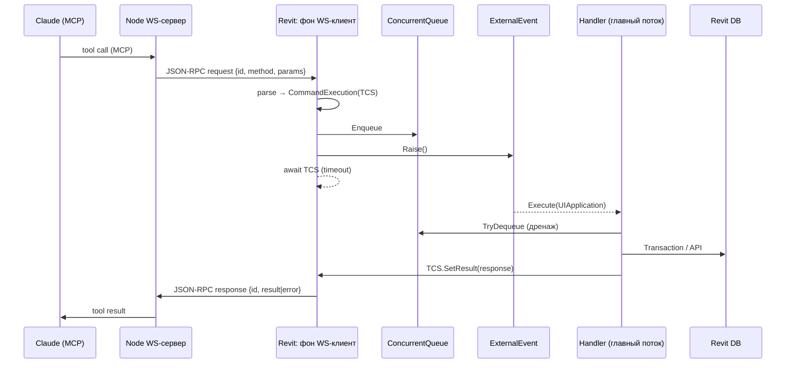

# Architecture: Revit MCP Bridge

Документ описывает архитектуру связи AI-клиента с Autodesk Revit через MCP-сервер (Node.js) и C# add-in (`RevitConnector` + `RevitCommandDispatcher`).

## Обзор

```
[ Claude / LLM ]
       │  MCP Protocol (stdio)
       ▼
[ Node.js MCP Server ]          ← server/
       │  WebSocket + JSON-RPC 2.0
       ▼
[ Revit Add-in: WS-клиент ]     ← RevitConnector (фоновый поток)
       │  ConcurrentQueue + ExternalEvent
       ▼
[ Revit Add-in: главный поток ] ← IExternalEventHandler
       │  Transaction (при записи)
       ▼
[ RevitCommandDispatcher ]      ← IRevitCommand / Revit API
       ▼
[ Autodesk Revit DB ]
```

Цепочка протоколов:

| Участок | Протокол | Роль Node | Роль Revit |
|---|---|---|---|
| LLM ↔ Node | MCP (JSON-RPC поверх stdio) | MCP-сервер | — |
| Node ↔ Revit | JSON-RPC 2.0 поверх WebSocket | WS-сервер / JSON-RPC-клиент | WS-клиент / JSON-RPC-сервер |

На TCP-уровне Revit **подключается** к Node (удобнее переподключаться при старте/остановке Revit). На уровне JSON-RPC Node **шлёт запросы**, Revit **отвечает**.

---

## Компоненты репозитория

### `server/` — MCP-сервер (TypeScript)

| Файл | Назначение |
|---|---|
| `src/index.ts` | Точка входа: поднимает WS-сервер и MCP `StdioServerTransport` |
| `src/utils/ConnectionManager.ts` | WS-сервер, корреляция ответов по `id`, `withRevitConnection()` |
| `src/tools/*.ts` | MCP-инструменты; вызовы Revit через `withRevitConnection(method, params)` |
| `src/tools/registerTools.ts` | Авторегистрация всех tool-модулей из папки |

Порт WS по умолчанию: `8080` (переопределяется через `REVIT_WS_PORT`).

### `RevitConnector/` — транспорт и мост потоков (C#)

Отвечает только за сеть, JSON-RPC и маршалинг на главный поток Revit. **Не** содержит бизнес-логики Revit API.

```
RevitConnector/
├─ Application/RevitConnectorApp.cs   # IExternalApplication: wiring + lifecycle
├─ Commands/                          # IExternalCommand ленты: статус и Reconnect
├─ UI/                                # лента MCP: индикатор и диалог статуса
├─ Core/
│  ├─ CommandExecution.cs             # request + TaskCompletionSource
│  └─ CommandExecutionHandler.cs      # IExternalEventHandler, дренаж очереди
├─ Transport/
│  ├─ WebSocketClient.cs              # ClientWebSocket, reconnect, heartbeat
│  └─ DataExchangeDispatcher.cs       # parse → enqueue → await → response
├─ Protocol/                          # DataExchange* DTO (JSON-RPC 2.0 wire)
│  ├─ DataExchangeRequest.cs
│  ├─ DataExchangeResponse.cs
│  ├─ DataExchangeError.cs
│  └─ DataExchangeErrorCodes.cs
├─ Configuration/ConnectorSettings.cs
└─ Utils/                             # Logger, PathManager
```

### `RevitCommandDispatcher/` — исполнение команд Revit API (C#)

| Файл | Назначение |
|---|---|
| `Commands/IRevitCommand.cs` | Контракт команды (`Method`, `RequiresTransaction`, `RequiresDocument`, `Execute`) |
| `Commands/CommandRegistry.cs` | `method → IRevitCommand`; builtins + загрузка плагинов из JSON |
| `Commands/CommandRegistryModels.cs` | DTO для `commandRegistry.json` |
| `Commands/Builtin/*` | Встроенные команды (`revit.ping`, `revit.getVersion`) |
| `RevitCommandExecutor.cs` | Резолв + обёртка в `Transaction` + rollback |
| `Exceptions/CommandExceptions.cs` | Типизированные ошибки → коды JSON-RPC |

`RevitConnector` ссылается на `RevitCommandDispatcher` через `ProjectReference`.

---

## Три ключевые архитектурные задачи

### 1. Маршалинг потоков (фоновый WS → главный поток Revit)

**Проблема.** Revit API однопоточен: вызов из фонового потока WebSocket даёт `InvalidOperationException`.

**Решение.**

1. Фоновый поток кладёт `CommandExecution` в `ConcurrentQueue<T>`.
2. Вызывает `ExternalEvent.Raise()` (неблокирующий).
3. Revit в idle вызывает `IExternalEventHandler.Execute(UIApplication)` **на главном потоке**.
4. `Execute` **дренирует всю очередь** циклом `while (TryDequeue)` — несколько `Raise()` могут схлопнуться в один `Execute`.

Один `ExternalEvent` на приложение сериализует доступ к API. `ExternalEvent.Create` выполняется только в `OnStartup` (валидный API-контекст).

### 2. Корреляция async запрос ↔ ответ (JSON-RPC `id`)

**Проблема.** Поток разорван: receive (фон) → очередь → Execute (главный) → send (фон). Ответы могут уходить не по порядку.

**Решение.** Корреляцию несёт `TaskCompletionSource<DataExchangeResponse>` внутри `CommandExecution` (создаётся с `RunContinuationsAsynchronously`, чтобы продолжение с WS-send не село на поток Revit):

1. Распарсить JSON-RPC → создать `CommandExecution`.
2. `Enqueue` + `Raise()`.
3. `await Completion.Task` с таймаутом (`ExecutionTimeoutMs`).
4. Сериализовать ответ и отправить (отправка защищена `SemaphoreSlim` — `ClientWebSocket.SendAsync` не потокобезопасен).

На стороне Node корреляция зеркальная: `Map<id, PendingRequest>` в `ConnectionManager`.

Нотификации (запрос без `id`) ответа не ждут.

### 3. Транзакции, контекст документа, жизненный цикл, ошибки

**Транзакции.** `RevitCommandExecutor` проверяет `RequiresTransaction`. Запись оборачивается в `Transaction`; при исключении — `RollBack`. Read-only команды идут без транзакции, но всё равно в API-контексте главного потока.

**Контекст документа.** Если у команды `RequiresDocument` или `RequiresTransaction`, перед исполнением проверяется `ActiveUIDocument` / `Document`. Отсутствие → `NoActiveDocumentException` (−32001). Application-level команды (`revit.ping`, `revit.getVersion`) ставят `RequiresDocument = false` и работают без открытого документа.

**Жизненный цикл.** `RevitConnectorApp.OnStartup` поднимает реестр, executor, очередь, `ExternalEvent`, WS-клиент. `OnShutdown` отменяет `CancellationToken`, dispose клиента и события.

**Устойчивость соединения.**

- **Reconnect** — бесконечный цикл с экспоненциальным backoff (`InitialBackoffMs` → ×2 → `MaxBackoffMs`), сброс после успешного коннекта. Ручной Reconnect увеличивает поколение соединения, отменяет текущую попытку и пропускает backoff. Цикл при этом не останавливается.
- **Protocol keep-alive** — `ClientWebSocket.Options.KeepAliveInterval`. Мёртвый TCP всплывает исключением в receive-loop.
- **Индикатор** — вкладка ленты `MCP` / панель `Connection`: кнопка статуса (цвет и текст) и кнопка `Reconnect`. Статус с фонового потока на главный попадает отдельным `ExternalEvent`, не через очередь команд.
- Тишина без RPC **не** рвёт сокет: у здоровой сессии часто нет трафика. `HeartbeatTimeoutMs` оставлен только для совместимости `connectorSettings.json`.

**Ошибки → JSON-RPC.**

| Код | Константа | Когда |
|---|---|---|
| −32700 | ParseError | битый JSON |
| −32600 | InvalidRequest | нет `method` / malformed |
| −32601 | MethodNotFound | метод не зарегистрирован |
| −32602 | InvalidParams | ошибка валидации params |
| −32603 | InternalError | непредвиденное исключение |
| −32000 | RevitApiError | ошибка Revit API |
| −32001 | NoActiveDocument | нет активного документа |
| −32002 | ExecutionTimeout | главный поток не ответил вовремя |

Исключение одной команды не роняет насос очереди и соединение.

---

## Поток одного вызова



Пример сквозного пути:

1. MCP tool `get-revit-version` → `withRevitConnection("revit.getVersion")`.
2. Node шлёт `{ "jsonrpc":"2.0", "id":"…", "method":"revit.getVersion" }`.
3. `DataExchangeDispatcher` → очередь → `CommandExecutionHandler`.
4. `RevitCommandExecutor` → `GetRevitVersionCommand.Execute`.
5. Ответ `{ "jsonrpc":"2.0", "id":"…", "result":{ "versionName":… } }` уходит обратно.

---

## Конфигурация

Файл `connectorSettings.json` рядом с DLL add-in (создаётся с дефолтами при первом старте):

| Поле | По умолчанию | Назначение |
|---|---|---|
| `ServerUri` | `ws://127.0.0.1:8080` | Endpoint Node WS-сервера |
| `ExecutionTimeoutMs` | `60000` | Ожидание обработки на главном потоке |
| `InitialBackoffMs` | `1000` | Стартовый интервал reconnect |
| `MaxBackoffMs` | `30000` | Потолок backoff |
| `HeartbeatIntervalMs` | `15000` | Keep-alive / период watchdog |
| `HeartbeatTimeoutMs` | `45000` | Не используется. Поле сохранено, чтобы старый json загружался |

Логи: `Logs/revit-connector-YYYYMMDD.log` рядом с DLL.

---

## Правила потокобезопасности (чек-лист)

- Revit API вызывается **только** внутри `IExternalEventHandler.Execute` — нигде в `Transport/*`.
- `ExternalEvent.Create` — один раз, в `OnStartup`.
- `Execute` дренирует **всю** очередь, а не одну команду.
- `TaskCompletionSource` — с `RunContinuationsAsynchronously`.
- `SendAsync` защищён `SemaphoreSlim(1,1)`.
- У каждого запроса — таймаут ожидания (модальные диалоги блокируют idle).
- Ошибка одной команды → JSON-RPC `error`, насос очереди продолжает работу.

---

## Как добавить новую команду

### Встроенная (built-in)

1. Реализовать `IRevitCommand` в `RevitCommandDispatcher/Commands/Builtin/` (`RequiresTransaction` / `RequiresDocument` по смыслу команды).
2. Зарегистрировать в `CommandRegistry.RegisterBuiltins()` (вызывается из `CreateDefault` / `LoadFrom`).
3. Добавить MCP tool в `server/src/tools/`, вызывающий `withRevitConnection("method.name", params)`.
4. Пересобрать C# add-in и Node (`npm run build`).

### Плагин через `commandRegistry.json`

При старте add-in:

1. `PathManager.GetCommandRegistryFilePath()` → `Commands/commandRegistry.json` (рядом с DLL; создаётся с примером, если файла нет).
2. `CommandRegistry.LoadFrom(...)` регистрирует builtins, затем загружает enabled-записи из JSON.

Формат записи:

```json
{
  "commands": [
    {
      "method": "revit.example",
      "assemblyPath": "ExamplePlugin.dll",
      "className": "ExamplePlugin.ExampleCommand",
      "enabled": true
    }
  ]
}
```

| Поле | Назначение |
|---|---|
| `assemblyPath` | DLL относительно `Commands/` (или абсолютный путь) |
| `className` | Полное имя типа с `IRevitCommand` и публичным ctor без параметров |
| `method` | Опционально; если задан, должен совпадать с `IRevitCommand.Method` |
| `enabled` | `false` — запись пропускается |

Ошибка одной плагин-записи логируется и **не** роняет старт add-in.

Граница ответственности: транспорт/мост — в `RevitConnector`; логика Revit API — только в `RevitCommandDispatcher` (и внешних plugin DLL).
